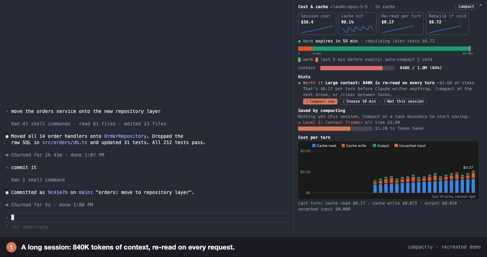
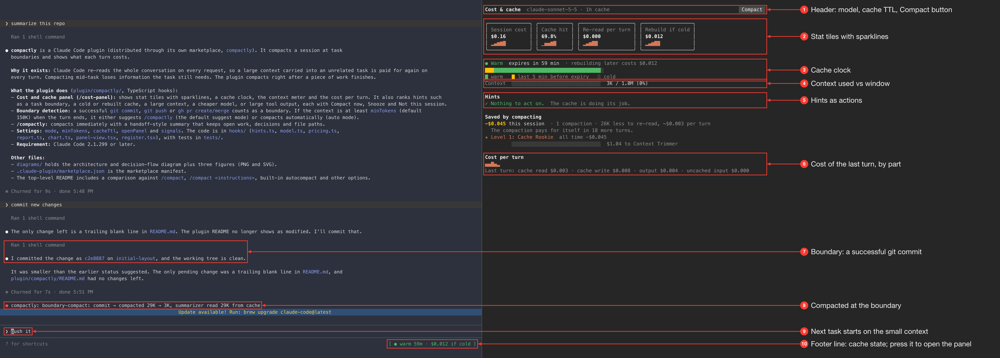
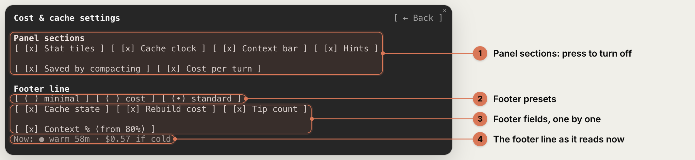
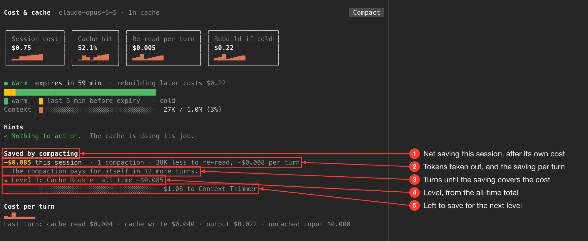
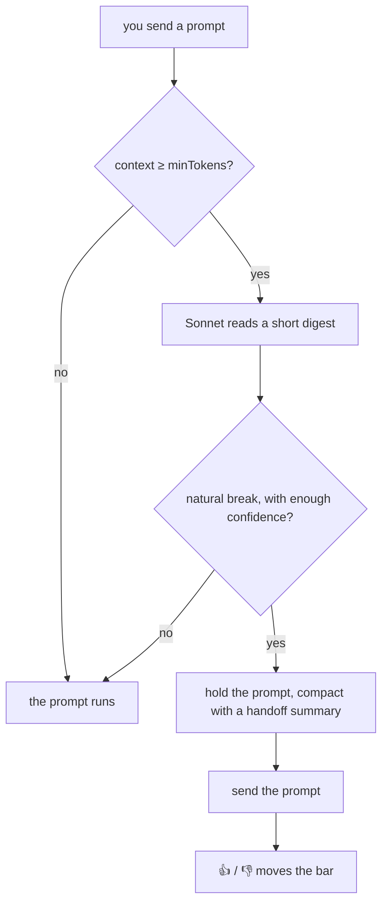

<h1 align="center">
  <picture>
    <source media="(prefers-color-scheme: dark)" srcset="images/logo/compactly-lockup-dark.svg">
    
  </picture>
</h1>

<p align="center"><b>Compact smartly.</b></p>

A Claude Code mod that compacts your session at task boundaries, with a handoff summary for
the next task, and shows what each turn costs and when the prompt cache expires. The name is
the idea: *compact smartly*, with the "smart" squeezed out.

https://github.com/user-attachments/assets/e05ea6ec-b28d-4a0d-ad48-c8f92520683b



Claude Code re-reads the whole conversation on every request, so a large context carried
into an unrelated task is paid for again on every turn. Compacting in the middle of a task
drops what it still needs. compactly compacts in between: right after the work is done.

- **Compacts at natural breaks**, with a summary written as a handoff for the next task.
- **Shows what each turn costs** and when the prompt cache expires.
- **Learns from your 👍 / 👎** on each automatic compaction.

## Install

Requires Claude Code 2.1.295 or later. compactly is a mod, installed through Claude Code's
plugin system. Inside Claude Code:

```
/plugin marketplace add swapnildahiphale/compactly
/plugin install compactly@compactly
```

Or from a shell:

```bash
claude plugin install compactly --marketplace swapnildahiphale/compactly
```

Start a new session afterwards. See [installation](docs/installation.md) for a local clone,
scopes, updating and uninstalling.

## Usage

- `/cost-panel` opens the cost & cache panel, or press the footer line beside the prompt.
- `/compactly` compacts now.
- By default (`auto` mode), Claude Sonnet reads each new prompt once the context is large. If
  the prompt starts after a natural break, the mod compacts first and then sends the prompt.
  A band above the prompt asks **👍 Yes** or **👎 No, I was mid-task**, and the judge learns
  from your answers.
- In `suggest` mode, the mod only tells you when a git commit, push or PR is a good moment to
  compact.

## The panel

Open it with `/cost-panel`, or press the footer line beside the prompt.



- **Header**: the model, the cache TTL, a **⚙ Settings** button and a **Compact** button.
- **Stat tiles** with sparklines: session cost, cache hit, re-read per turn, rebuild if cold.
- **Cache clock**: drains as the cache ages, with a compact window before it goes cold.
- **Context**: tokens used against the model's window.
- **Hints**: ranked actions: compact now, snooze 10 min, not this session.
- **Cost per turn**: cache read, cache write, output and uncached input.
- **Footer line**: a one-line summary such as `● warm 59m · $0.012 if cold`, visible even
  when the panel is closed.

**⚙ Settings** chooses which sections the panel draws and which fields the footer line
carries, by preset (`minimal`, `cost`, `standard`) or one at a time. See
[settings](docs/panel.md#settings).



**Saved by compacting** keeps score of what your compactions saved after their own cost, and
an all-time total earns levels from Cache Rookie to Compaction Legend.



Details: [the panel](docs/panel.md).

## How it decides

In `auto` mode, a judge model decides when you send your next prompt:



- If no prompt follows a commit, push or PR, it compacts 5 minutes before the cache expires,
  once the context is at least `minTokens` and your work isn't paused.
- If your recent prompts say work is paused, git signals don't compact automatically.
- In `suggest` mode it only tells you when a commit, push or PR is a good moment.

Details: [how it works](docs/how-it-works.md), [decision flows](diagrams/architecture.md).

## How it compares

| Option | When it runs | Summary |
|---|---|---|
| `/compact` | when you type it | general history of the conversation |
| autocompact (built in) | when the context nears the window limit | general |
| idle compaction (built in) | after about 55 min idle, context ≥ 200K | general |
| `/clear`, new session | when you run it | none; only CLAUDE.md and memory remain |
| **`/compactly`** (or automatic) | when you type it, or at a natural break before the next prompt | handoff for the next task |

The trade-off: the judge is sometimes wrong, so some automatic compactions land mid-task.
Rate them and it becomes more careful, or set `mode` to `suggest` to confirm each one.
Details: [how it works](docs/how-it-works.md#how-it-compares).

## Configuration

The defaults work as they are. The settings people change most:

| Setting | Default | Meaning |
|---|---|---|
| `mode` | `auto` | `suggest`: notify only; `auto`: compact at a natural break; `off`: do nothing |
| `judge` | `sonnet` | `sonnet`, `haiku` (cheaper, compacts less often), or `off` |
| `minTokens` | `150000` | act only when the context is at least this large |

```bash
claude plugin install compactly --marketplace swapnildahiphale/compactly \
  --config mode=suggest --config minTokens=100000
```

Details: [configuration](docs/configuration.md), [installation](docs/installation.md).

## Privacy

The mod makes no network calls of its own. The judge runs through Claude Code with the model
you pick. Ratings and savings totals are kept in the mod's own store under `~/.claude`, on your
machine.

## Contributing

Issues and pull requests are welcome. To work on the mod from a clone, see
[Develop](plugin/compactly/README.md#develop).

## License

[Apache License 2.0](LICENSE)
